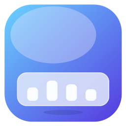
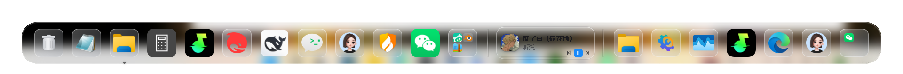
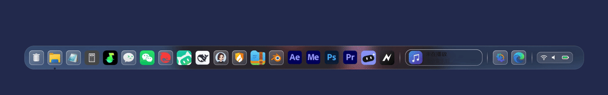
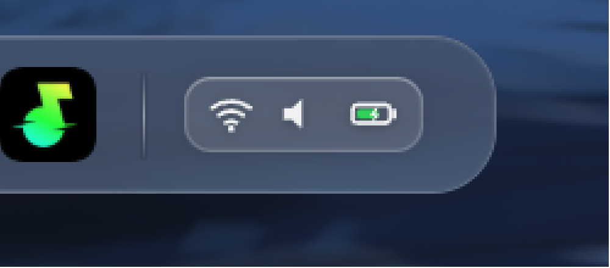
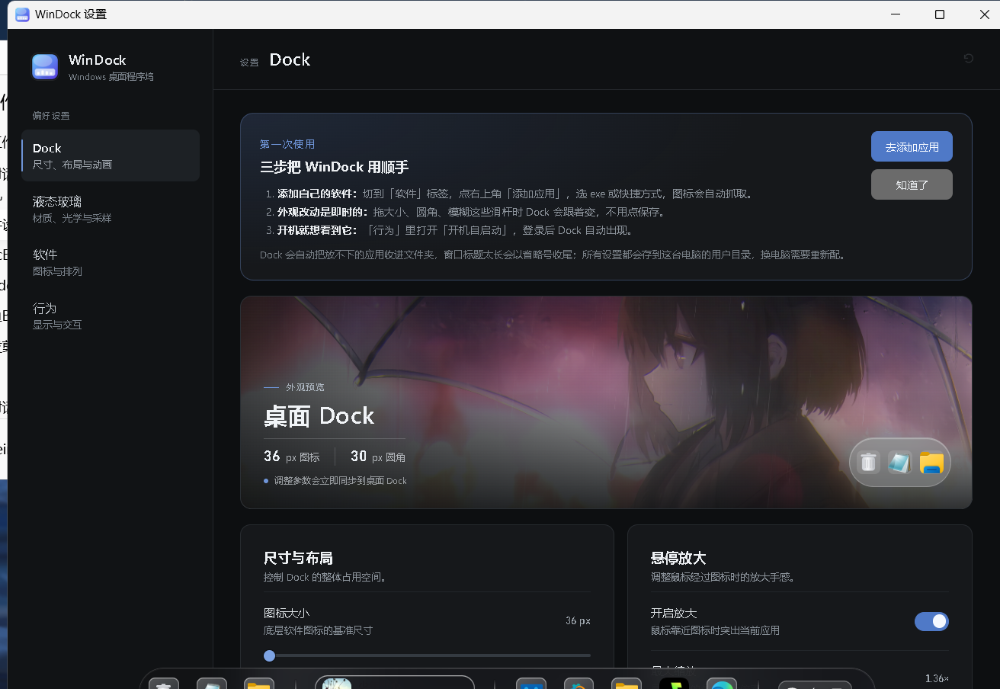
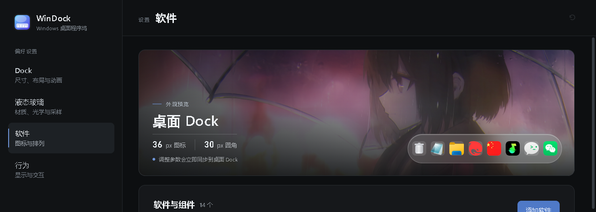

<div align="center">
  
  <h1>WinDock</h1>
  <p><strong>A macOS-style Dock, rebuilt for the Windows desktop.</strong></p>
  <p>A liquid-glass Dock that does not rely on <code>backdrop-filter</code>: icons magnify under the cursor, and your apps, folders, music, minimized windows, plus Wi‑Fi / volume / battery status are all within reach.</p>
  <p>
    <a href="https://github.com/weirdo580/windock/releases/latest"></a>
    <a href="https://github.com/weirdo580/windock"></a>
    <a href="https://github.com/weirdo580/windock"></a>
    <a href="https://github.com/weirdo580/windock"></a>
    <a href="LICENSE"></a>
  </p>
  <p><strong><a href="https://github.com/weirdo580/windock/releases/latest">Download for Windows</a></strong> · <a href="#features">Features</a> · <a href="#build-from-source">Build from source</a> · <a href="CHANGELOG.md">Changelog</a> · <a href="https://github.com/weirdo580/windock/issues">Issues</a> · <a href="README.md">简体中文</a></p>
</div>

WinDock lives at the bottom of your screen. It stays quiet by default; hover an icon and it magnifies with macOS-style attraction, click and the app launches. The base, tooltips and rename popover are rendered with WebGL2 / GLSL for real refraction, Fresnel rim light and slight dispersion — no static frosted-glass texture. On the far right sits a always-on system status capsule, one click away from a Windows-style quick settings panel.





## Features

### Liquid glass base

- Real-time WebGL2 refraction and rim highlights that follow the desktop behind it.
- Desktop frames are captured through `desktopCapturer`; when blur is enabled, `setContentProtection` keeps the Dock itself out of the capture so icons are never copied into the background.
- Capture interval, capture width, corner radius, rim light and blur are all adjustable.
- Capture width is **automatic by default**: it follows the primary display's physical width (resolution × scale factor), so switching monitors or changing display scaling needs no manual tuning. A fixed width is still supported.
- The bottom margin has an automatic mode too: it tracks the taskbar height, so hiding, resizing or moving the taskbar just works.
- DRM-protected video, the UAC secure desktop and some exclusive-fullscreen games cannot be captured; WinDock then falls back to an analyzed ambient color instead of degrading to CSS frosted glass.

### System status bar and quick panel

The rightmost part of the Dock is a status capsule, separated from the icon row by a divider, and it shows real system state:

- **Wi‑Fi** — current network name, shown in a tooltip, click to open the network list.
- **Volume** — master volume and mute state, the glyph follows the level.
- **Battery** — remaining percentage and charging state, with distinct glyphs for full, low and charging.
- Click the capsule to open the **quick panel**: Wi‑Fi list (connected / saved / secured), airplane mode, power saving, brightness slider, volume slider and a battery footer — the same interaction model as the built-in Windows panel.
- **Capability detection** on first launch: desktops without a battery, without brightness control, without a wireless adapter or with a single input method simply hide the corresponding modules, so no dead controls are left behind.



### Icons, folders and drag & drop

- Hover magnification follows the macOS attraction curve; the base grows with the icon row.
- Click to launch, a dot marks running apps, optional bounce feedback on click.
- Drop an `.exe`, `.lnk`, image or plain file to add it; icons are extracted automatically and inserted before the Trash.
- Drag icons to reorder; the order is persisted. The Trash is pinned to the far right.
- Folder icons open a popover panel, so common files do not require another Explorer window; the panel sizes itself to the available space, never covering the Dock and never scrolling.
- Every app can use a custom icon and be reset to the default one.

### Music and minimized windows

- The music tile reads the Windows media session and shows the current track, artist and playback state.
- Previous / play-pause / next controls, with the two dividers always present.
- The minimized-windows zone sits to the right of the music tile: empty when nothing is minimized, otherwise the window icons appear and clicking restores the window.
- Music tile, minimized zone and dividers all participate in the Dock layout instead of overlapping each other.

### Settings and system integration

- A dedicated settings window: icon size, Dock height, gap, corner radius, glass parameters and behavior update the live Dock instantly.
- Grouped as Dock / Liquid glass / Apps / Behavior, with live preview, autosave and a discard option.
- **First-run guide**: the first time the settings window opens it shows a "three steps to make WinDock feel right" card — where to add apps, that appearance changes are instant, and how to enable autostart.
- Tray menu to open settings, show the Dock or quit; launching WinDock again focuses the existing instance and opens settings.
- Autostart, always-on-top, auto-hide, hover tooltips and the idle bottom line when collapsed.
- Single instance, so you never end up with two Docks.





## Download and install

Get the **[latest release](https://github.com/weirdo580/windock/releases/latest)** (currently **v1.1.0**):

| File | How to use |
| --- | --- |
| `WinDock-Setup-1.1.0.exe` | **Recommended.** Installer, lets you pick a folder, creates desktop and Start-menu shortcuts |
| `SHA256SUMS.txt` | Optional integrity check via `Get-FileHash -Algorithm SHA256` |

After installing, run `WinDock.exe` and the Dock appears at the bottom of the screen. Running it again opens the settings window of the existing instance, or use the tray menu.

**Requirements**: Windows 10 2004+ or Windows 11, x64; a GPU driver with WebGL2 support; keep Electron hardware acceleration enabled. No macOS, Linux or ARM64 builds.

The installer is not code-signed, so SmartScreen may warn about an unknown publisher. Verify the repository and `SHA256SUMS.txt` before running.

## Build from source

Node.js 20 LTS+ and npm 10+, on Windows 10 / 11.

```powershell
npm install
npm run dev
```

`npm run dev` starts Vite and Electron together with hot reload for Vue, CSS and shaders.

Run an existing build:

```powershell
npm run build
npm start
```

Build the NSIS installer:

```powershell
npm run dist
```

Build a portable single-file version:

```powershell
npm run dist:portable
```

Artifacts land in `release/`. The first build downloads the Electron binaries and electron-builder dependencies.

## Configuration

During development WinDock reads `app-config.json` in the project root; the installed app writes to:

```text
%APPDATA%\WinDock\app-config.json
```

On first run the built-in defaults are copied there. [`app-config.example.json`](app-config.example.json) is a clean sample without any personal paths.

Key fields:

```json
{
  "dock": {
    "height": 52,
    "iconSize": 36,
    "maxScale": 1.36,
    "autoHide": false,
    "bottomMargin": 0
  },
  "glass": {
    "captureInterval": 100,
    "captureWidth": 0,
    "captureWidthAuto": true
  }
}
```

`path` accepts exe, lnk and plain files, plus environment variables such as `%WINDIR%`. `icon` accepts png, ico, svg, jpg and webp; leave it empty to extract the app icon.

`captureWidth: 0` with `captureWidthAuto: true` means the capture width follows the primary display; `bottomMargin: 0` means the bottom margin follows the taskbar. Setting a number pins it.

## Project layout

```text
electron/main.cjs                  transparent windows, desktop capture, tray, config
electron/preload.cjs               IPC allowlist
electron/win-bridge.ps1            window layering helpers
electron/media-bridge.ps1          Windows media session reader
electron/status-watch.ps1          status sampling: volume, Wi‑Fi, battery, capabilities
electron/status-act.ps1            status capsule actions
electron/quick-act.ps1             quick panel actions: Wi‑Fi, airplane mode, brightness
src/App.vue                        Dock state, magnification curve, drag, auto-hide
src/SettingsApp.vue                settings window, live preview, first-run guide
src/components/LiquidGlass.vue     WebGL2 lifecycle and HiDPI mapping
src/components/DockIcon.vue        icon, running dot, bounce, drag events
src/components/DockFolder.vue      folder popover
src/components/MusicTile.vue       music tile
src/components/MinimizedZone.vue   minimized windows zone
src/components/StatusTray.vue      system status capsule
src/components/QuickPanel.vue      Windows-style quick settings panel
src/shaders/                       GLSL refraction, ambient color, Fresnel
public/icons/                      default sample icons
build/                             icons, default config, packaging scripts
```

## Privacy and limitations

- No telemetry, accounts or backend. App lists, icons and window state stay on your machine.
- Volume, battery level and network name read by the status bar are displayed locally only and never uploaded; unsupported hardware hides the module.
- The installed app stores its config at `%APPDATA%\WinDock\app-config.json`, which may contain your own app paths — redact it before opening an issue.
- Desktop capture is used locally for glass rendering only and never uploaded; protected surfaces cannot be captured.
- The music tile depends on the Windows media session exposed by the player; when nothing is playing it shows "not playing", and some players are not compatible.
- Magnification, refraction and window layering all run locally; multi-monitor, mixed DPI and unusual GPU drivers may still show subtle differences.
- WinDock never modifies or deletes your programs; removing an icon only affects the Dock.

## License

Original WinDock code is released under the [MIT License](LICENSE). Electron, Vue, Vite and their dependencies keep their own licenses; third-party icons and wallpaper assets belong to their original authors.

If WinDock is useful to you, a **Star** helps a lot — and feel free to open an [issue](https://github.com/weirdo580/windock/issues) with bugs or ideas.
