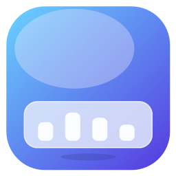
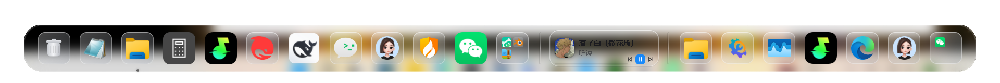
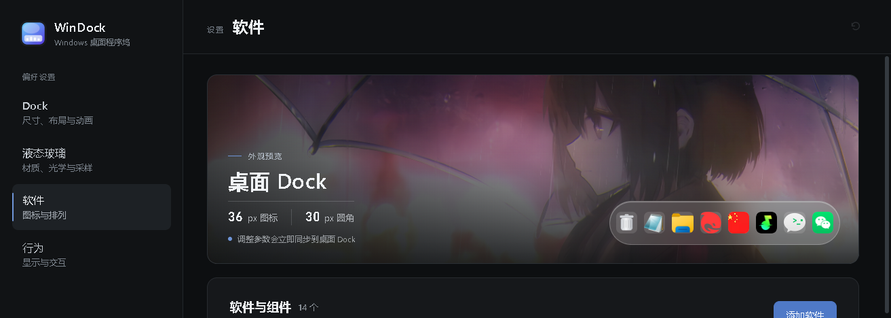

<div align="center">
  
  <h1>WinDock</h1>
  <p><strong>把 macOS 式程序坞，放进 Windows 桌面。</strong></p>
  <p>一个不依赖 <code>backdrop-filter</code> 的液态玻璃 Dock，图标会跟着鼠标放大，常用软件、文件夹、音乐和最小化窗口都在手边。</p>
  <p>
    <a href="https://github.com/weirdo580/windock/releases/latest"></a>
    <a href="#下载安装"></a>
    <a href="#从源码运行"></a>
    <a href="#从源码运行"></a>
    <a href="LICENSE"></a>
  </p>
  <p><strong><a href="https://github.com/weirdo580/windock/releases/latest">下载 Windows 版</a></strong> · <a href="#功能">功能</a> · <a href="#从源码运行">从源码运行</a> · <a href="https://github.com/weirdo580/windock/issues">问题反馈</a></p>
</div>

WinDock 是给 Windows 桌面用的程序坞。它贴在屏幕底部，默认保持干净、轻巧；鼠标经过图标时会像 macOS 一样放大，点击即可启动应用。底座、Tooltip 和重命名面板使用 WebGL2 / GLSL 做实时折射、菲涅尔高光和轻微色散，不使用静态磨砂贴图。



## 功能

### 液态玻璃底座

- WebGL2 实时渲染曲面折射、边缘高光和饱和度，跟随桌面画面变化。
- 通过 `desktopCapturer` 低频采样真实桌面，再用 `setContentProtection` 把 Dock 排除在截图之外，避免玻璃反复采样自己。
- 指针停在 Dock 上时会暂停采样；采样间隔、采样宽度、圆角、折射、模糊和浓度都能在设置里调整。
- DRM 受保护视频、UAC 安全桌面和部分独占全屏游戏无法被普通桌面程序采样，此时使用分析环境色兜底，不会退化成 CSS 毛玻璃。

### 图标、文件夹和拖放

- 鼠标悬停时图标按 macOS 风格的磁吸曲线放大，底板宽度跟着图标行一起变化。
- 点击图标启动程序，运行时显示小圆点；可开启点击回弹。
- 拖入 `.exe`、`.lnk`、图片或普通文件，自动提取图标并插入到废纸篓之前。
- 拖动 Dock 图标可以重新排序，顺序会写入配置；废纸篓固定在最右侧。
- 文件夹图标支持弹出式内容面板，常用文件不用反复开资源管理器。
- 每个软件都可以更换自定义图标，也可以一键恢复默认图标。

### 音乐和最小化窗口

- Dock 中间的音乐组件会读取 Windows 媒体会话，显示当前歌曲、歌手和播放状态。
- 支持上一首、播放／暂停、下一首，左右两条分隔线常驻，不会因为窗口状态被吞掉。
- 最小化窗口区位于音乐右侧；没有最小化窗口时保持空位，有窗口时显示窗口图标，点击即可恢复。
- 音乐组件、最小化窗口和分隔线都参与 Dock 的布局，不会互相覆盖。

### 设置和系统集成

- 独立设置窗口，修改图标大小、Dock 高度、间距、圆角、玻璃参数、显示行为后立即同步到桌面 Dock。
- 设置项按「Dock / 液态玻璃 / 软件 / 行为」分组，支持实时预览、自动保存和放弃未保存修改。
- 托盘菜单可以打开设置、显示 Dock 或退出程序；再次启动 WinDock 会唤起已有实例并打开设置。
- 支持开机自启动、始终置顶、自动隐藏、悬停名称提示和底部感应条。
- 单实例运行，避免重复启动多个 Dock。



## 下载安装

前往 **[最新正式版](https://github.com/weirdo580/windock/releases/latest)**：

| 下载文件 | 使用方式 |
| --- | --- |
| `WinDock-Setup-1.0.0.exe` | **推荐**。双击安装，可选择安装目录，创建桌面和开始菜单快捷方式 |
| `SHA256SUMS.txt` | 下载校验，可用 PowerShell `Get-FileHash -Algorithm SHA256` 比对 |

安装完成后运行 `WinDock.exe`，Dock 会显示在屏幕底部。需要修改设置时，可以再次双击 `WinDock.exe`（已运行时只会唤起设置窗口），或从托盘菜单选择「打开设置」。

**系统要求**：Windows 10 2004 或更高版本 / Windows 11，x64；需要支持 WebGL2 的显卡驱动，建议不要禁用 Electron 硬件加速。暂不提供 macOS、Linux 或 ARM64 成品包。

当前安装包没有商业代码签名，Windows SmartScreen 可能提示「未知发布者」。请核对仓库来源和 `SHA256SUMS.txt` 后再运行。

## 从源码运行

需要 Node.js 20 LTS 或更高版本、npm 10 或更高版本，以及 Windows 10 / 11。

```powershell
npm install
npm run dev
```

`npm run dev` 会同时启动 Vite 和 Electron；修改 Vue、CSS、Shader 后会热更新。

只运行已经构建的版本：

```powershell
npm run build
npm start
```

生成 NSIS 安装包：

```powershell
npm run dist
```

生成单文件便携版：

```powershell
npm run dist:portable
```

产物位于 `release/`。首次打包需要联网下载 Electron 二进制和 electron-builder 依赖。

## 配置

开发环境读取项目根目录的 `app-config.json`；安装版的可写配置位于：

```text
%APPDATA%\WinDock\app-config.json
```

第一次运行安装版时，会把内置默认配置复制到用户目录。仓库里的 [`app-config.example.json`](app-config.example.json) 是一份干净的示例，不包含任何个人软件路径。

常用字段：

```json
{
  "apps": [
    {
      "id": "notepad",
      "name": "记事本",
      "path": "%WINDIR%\\System32\\notepad.exe",
      "icon": "icons/notepad.svg"
    },
    { "type": "separator", "id": "group-1" },
    { "type": "music", "id": "music", "name": "音乐" },
    { "type": "minimized", "id": "minimized", "name": "最小化窗口" }
  ],
  "dock": {
    "height": 52,
    "iconSize": 36,
    "maxScale": 1.36,
    "autoHide": false
  },
  "glass": {
    "refraction": 0,
    "fresnel": 0.39,
    "blur": 1.06,
    "opacity": 0,
    "radius": 30
  }
}
```

`path` 支持 exe、lnk 和普通文件，也支持 `%WINDIR%` 这类环境变量；`icon` 支持 png、ico、svg、jpg、webp，留空则自动提取程序图标。

## 项目结构

```text
electron/main.cjs                  透明窗口、桌面采样、托盘、配置和系统能力
electron/preload.cjs               安全 IPC 白名单
electron/win-bridge.ps1            Dock 与普通窗口的层级协调
electron/media-bridge.ps1          Windows 媒体会话读取
src/App.vue                        Dock 状态、磁吸曲线、拖拽和自动隐藏
src/SettingsApp.vue                独立设置页与实时预览
src/components/LiquidGlass.vue     WebGL2 生命周期与高分屏映射
src/components/DockIcon.vue        图标、运行圆点、弹跳与拖拽事件
src/components/DockFolder.vue      文件夹弹出面板
src/components/MusicTile.vue       音乐播放条
src/components/MinimizedZone.vue   最小化窗口区
src/shaders/                       GLSL 折射、环境色和菲涅尔
public/icons/                      默认示例图标
build/                             图标、默认配置和打包脚本
```

## 隐私与限制

- WinDock 不包含遥测、账号系统或自建上传后台；软件列表、图标和窗口状态都留在本机。
- 安装版的配置保存在 `%APPDATA%\WinDock\app-config.json`，可能包含你自己的软件路径。提交 Issue 或截图前请先脱敏。
- 桌面采样只在本地用于玻璃渲染，不会上传；受 Windows 安全策略保护的画面无法采样。
- 音乐组件依赖播放器提供的 Windows 媒体会话；没有媒体信息时显示「未在播放」，个别播放器可能不兼容。
- 图标放大、玻璃折射和窗口层级都在本机完成；多显示器、不同 DPI 和不同显卡驱动仍可能存在细微差异。
- 这是桌面增强工具，不会修改或删除原程序；从 Dock 移除图标只影响显示，不会卸载软件。

## 开源许可

WinDock 原创代码采用 [MIT License](LICENSE)。Electron、Vue、Vite 及其依赖沿用各自的许可；第三方图标和壁纸素材的权利归原作者所有。

如果 WinDock 对你有帮助，欢迎点一个 **Star**，也欢迎在 [Issues](https://github.com/weirdo580/windock/issues) 里反馈问题或提出建议。
